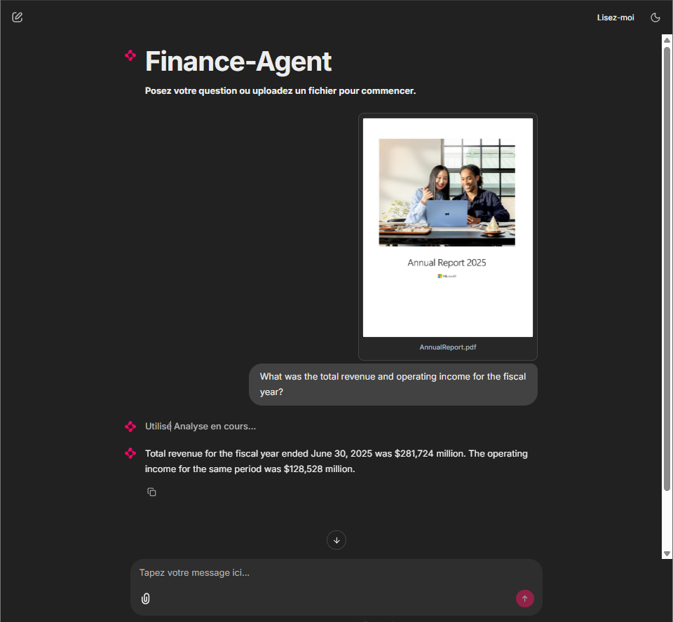
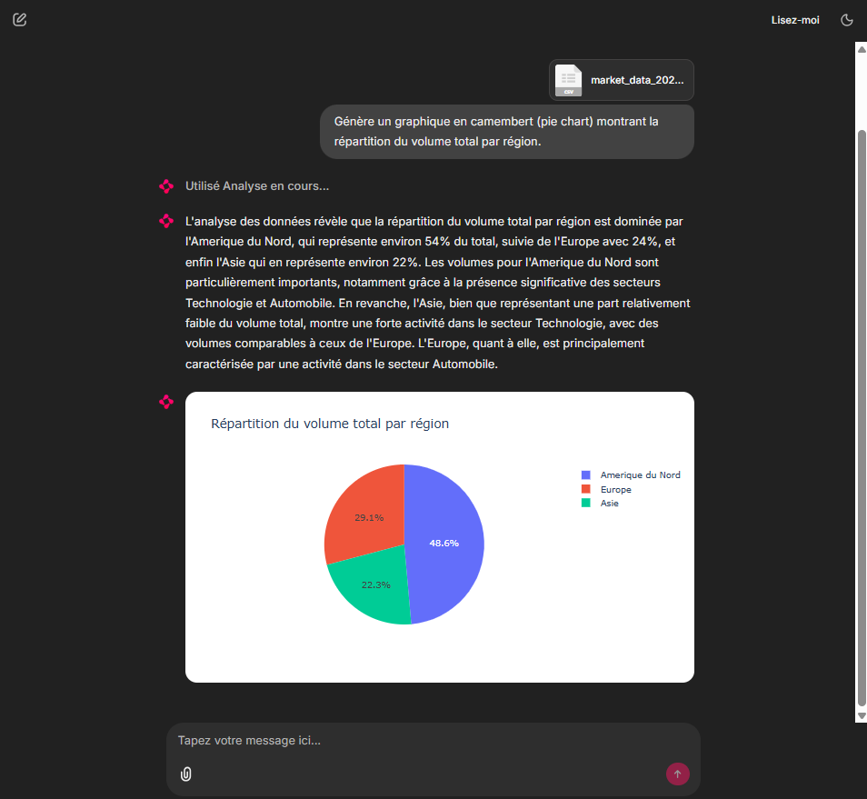
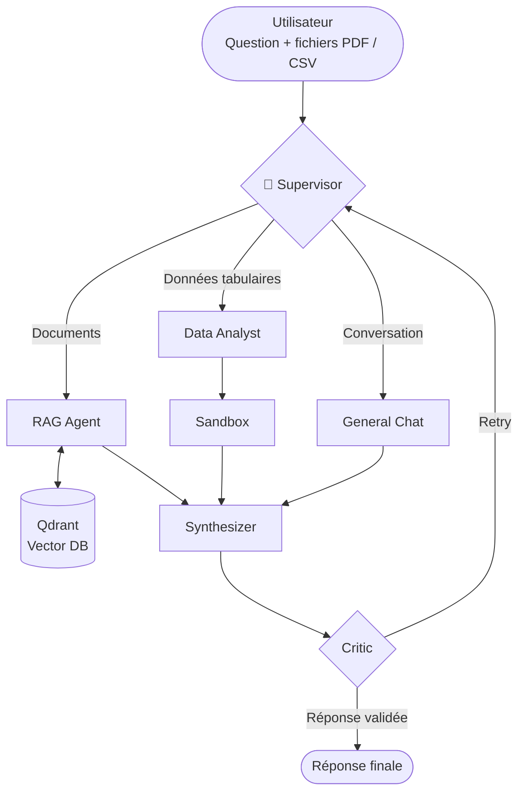

<div align="center">

# Finance-Agent

### Système RAG agentique multi-agents pour l'analyse financière

*Documents PDF, données CSV/Excel, exécution de code sécurisée et auto-correction des réponses, 100 % en local.*

[](https://www.python.org/)
[](https://python.langchain.com/)
[](https://langchain-ai.github.io/langgraph/)
[](https://ollama.com/)
[](https://qdrant.tech/)
[](https://chainlit.io/)
[](https://www.docker.com/)
[](LICENSE)

[Fonctionnalités](#-fonctionnalités) •
[Architecture](#-architecture) •
[Démarrage rapide](#-démarrage-rapide) •
[Configuration](#-configuration) •
[Évaluation](#-évaluation-ragas) •
[Structure](#-structure-du-projet)

<br/>

<table>
  <tr>
    <td align="center" width="50%">
      
    </td>
    <td align="center" width="50%">
      
    </td>
  </tr>
  <tr>
    <td align="center"><sub><b>Agent RAG</b> : question sur un rapport annuel PDF</sub></td>
    <td align="center"><sub><b>Agent Data Analyst</b> : graphique Plotly généré depuis un CSV</sub></td>
  </tr>
</table>

</div>

---

## 📖 À propos

**Finance-Agent** est un assistant d'analyse financière qui combine **RAG** (Retrieval-Augmented Generation) et **agents autonomes**. Il répond à des questions portant sur :

- des **rapports financiers au format PDF** (recherche sémantique dans le texte) ;
- des **données de marché au format CSV / Excel** (analyse et visualisation par génération de code Python).

Contrairement à un chatbot RAG linéaire, un **Superviseur** décide dynamiquement quel agent traite chaque requête. Le code généré par le LLM est exécuté dans une **sandbox**, et un **agent Critique** valide la réponse avant affichage, avec relance automatique en cas d'échec.

Tout fonctionne **en local** (Ollama + Qdrant) : aucune donnée financière ne quitte la machine pour l'inférence.

---

## ✨ Fonctionnalités

| | Fonctionnalité | Description |
|---|---|---|
| 🧠 | **Orchestration multi-agents** | Graphe LangGraph avec un Superviseur qui route chaque requête vers l'agent adapté. |
| 📄 | **Agent RAG** | Recherche sémantique dans les PDF via Qdrant et des embeddings locaux. |
| 📊 | **Agent Data Analyst** | Génère du code Python (Pandas / Plotly) pour analyser des CSV/Excel et produire des graphiques interactifs. |
| 🛡️ | **Exécution sécurisée** | Sandbox bloquant les imports dangereux (`os`, `subprocess`) dans le code produit par le LLM. |
| 🔍 | **Auto-correction** | Un agent Critique évalue la réponse et déclenche une nouvelle tentative si nécessaire. |
| 🔒 | **Local-first** | LLM et base vectorielle exécutés en local pour une confidentialité totale. |
| 📏 | **Évaluation mesurée** | Benchmark RAGAS sur un « Golden Set » de questions. |

---

## 🏗️ Architecture



### Flux d'une requête

1. **Supervisor** : analyse la question et les fichiers fournis, puis choisit l'agent.
2. **Agent spécialisé** : le RAG interroge les PDF, le Data Analyst génère du code exécuté en sandbox, le Chat gère la conversation générale.
3. **Synthesizer** : consolide les résultats en une réponse unique.
4. **Critic** : valide la réponse ou renvoie la requête au Superviseur pour une nouvelle tentative.

---

## 🛠️ Stack technique

| Catégorie | Technologies |
|---|---|
| Orchestration | LangGraph, LangChain |
| LLM (local) | Ollama · `qwen2.5:7b` |
| Embeddings | Ollama · `nomic-embed-text` |
| Base vectorielle | Qdrant |
| Data / Visualisation | Pandas, NumPy, Plotly, openpyxl |
| Ingestion PDF | pypdf |
| Interface | Chainlit |
| Évaluation | RAGAS, Hugging Face `datasets` · LLM juge : Groq (`openai/gpt-oss-120b`) |
| Sandbox | Blocage d'imports en local · intégration E2B (`e2b-code-interpreter`) |
| Conteneurisation | Docker, Docker Compose |

---

## 🚀 Démarrage rapide

### Prérequis

- [Python 3.11+](https://www.python.org/downloads/)
- [Docker](https://www.docker.com/) (pour Qdrant)
- [Ollama](https://ollama.com/) installé et lancé

### Installation

```bash
# 1. Cloner le dépôt
git clone https://github.com/MDMAK04/finance-agentic-rag.git
cd finance-agentic-rag

# 2. Créer l'environnement virtuel
python -m venv .venv
source .venv/bin/activate        # Windows : .venv\Scripts\activate

# 3. Installer les dépendances
pip install -r requirements.txt

# 4. Télécharger les modèles Ollama
ollama pull qwen2.5:7b
ollama pull nomic-embed-text
```

### Configuration

```bash
cp .env.example .env
```

Les valeurs par défaut conviennent pour un usage 100 % local. Les clés API ne sont nécessaires que pour l'évaluation RAGAS et la sandbox E2B (voir [Configuration](#-configuration)).

### Lancement

```bash
# 1. Démarrer Qdrant en arrière-plan
docker compose up qdrant -d

# 2. Démarrer l'interface Chainlit
chainlit run ui/app.py -w
```

Ouvrir **http://localhost:8000** dans le navigateur, puis déposer un PDF ou un CSV et poser une question.

---

## ⚙️ Configuration

Toute la configuration passe par le fichier `.env` (modèle : `.env.example`).

| Variable | Valeur par défaut | Rôle |
|---|---|---|
| `OLLAMA_BASE_URL` | `http://localhost:11434` | Adresse du serveur Ollama |
| `OLLAMA_MODEL` | `qwen2.5:7b` | LLM utilisé par les agents |
| `OLLAMA_EMBED_MODEL` | `nomic-embed-text` | Modèle d'embeddings |
| `QDRANT_URL` | `http://localhost:6333` | Adresse de Qdrant |
| `QDRANT_COLLECTION` | `finance_docs` | Collection des documents indexés |
| `OPENAI_API_KEY` / `OPENAI_MODEL` | — | Clé et modèle du LLM juge (évaluation RAGAS uniquement) |
| `E2B_API_KEY` | — | Clé pour la sandbox E2B (optionnel) |
| `CHUNK_SIZE` | `1000` | Taille des chunks de texte |
| `CHUNK_OVERLAP` | `150` | Chevauchement entre chunks |
| `TOP_K` | `5` | Nombre de chunks récupérés par requête |
| `MAX_RETRIES` | `2` | Nombre maximal de relances après rejet du Critic |
| `LOG_LEVEL` | `INFO` | Niveau de logs |

---

## 📊 Évaluation (RAGAS)

La fiabilité du système est mesurée avec **RAGAS** sur un « Golden Set » de questions couvrant les trois types de requêtes (RAG, Data, General), avec Groq comme LLM juge.

| Métrique | Score | Analyse |
|---|---|---|
| **Answer Relevancy** | **88.28 %** | Les réponses sont très pertinentes par rapport aux questions posées. |
| **Faithfulness** | 50.00 % | Hallucinations légères, limite du modèle 7B local. |
| **Context Precision** | 40.00 % | La recherche vectorielle remonte parfois du bruit. |

### 🔭 Pistes d'amélioration

- **Faithfulness** : passer à un modèle 14B ou plus, ou affiner les prompts.
- **Context Precision** : ajouter un **Reranker** (ex. Cohere) pour filtrer les chunks avant génération.

---

## 📁 Structure du projet

```text
finance-agentic-rag/
├── agents/                  # Les agents du graphe
│   ├── supervisor.py        #   Routage des requêtes
│   ├── rag_agent.py         #   Recherche dans les PDF
│   ├── data_agent.py        #   Analyse CSV/Excel + graphiques
│   ├── general_agent.py     #   Conversation générale
│   ├── synthesizer.py       #   Consolidation de la réponse
│   └── critic.py            #   Validation / relance
├── core/                    # Infrastructure
│   ├── graph.py             #   Graphe LangGraph
│   ├── state.py             #   État partagé du graphe
│   ├── routing_rules.py     #   Règles de routage
│   ├── llm.py               #   Configuration du LLM
│   ├── ingestion.py         #   Ingestion et découpage des documents
│   ├── vector_store.py      #   Accès à Qdrant
│   └── sandbox/             #   Exécution sécurisée du code généré
├── ui/
│   └── app.py               # Interface Chainlit
├── evaluation/              # Scripts RAGAS et Golden Set
├── tests/                   # Tests
├── data/                    # PDF et CSV d'exemple
├── docs/                    # Captures d'écran
│   ├── screenshot_pdf.png
│   └── screenshot_csv.png
├── .chainlit/               # Configuration Chainlit
├── chainlit.md              # Page d'accueil Chainlit
├── .env.example             # Modèle de configuration
├── Dockerfile
├── docker-compose.yml
└── requirements.txt
```

---

## 🐳 Docker

`docker-compose.yml` définit deux services :

| Service | Image / build | Ports |
|---|---|---|
| `qdrant` | `qdrant/qdrant:latest` | `6333`, `6334` (stockage persistant dans `./qdrant_storage`) |
| `app` | build du `Dockerfile` (Python 3.11-slim) | `8000` |

```bash
docker compose up qdrant -d    # Qdrant seul (usage recommandé en local)
```

---

## 👤 Auteur

**Mohammed El Makhloufi**
Étudiant en Master Machine Learning & Multimedia Intelligence (USMBA, Fès), orienté NLP / LLM / RAG.

[](https://github.com/MDMAK04)
[](https://linkedin.com/in/mohammed-el-makhloufi)

---

## 📄 Licence

Distribué sous licence MIT. Voir le fichier [`LICENSE`](LICENSE).
